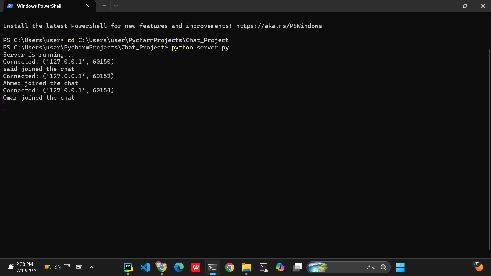
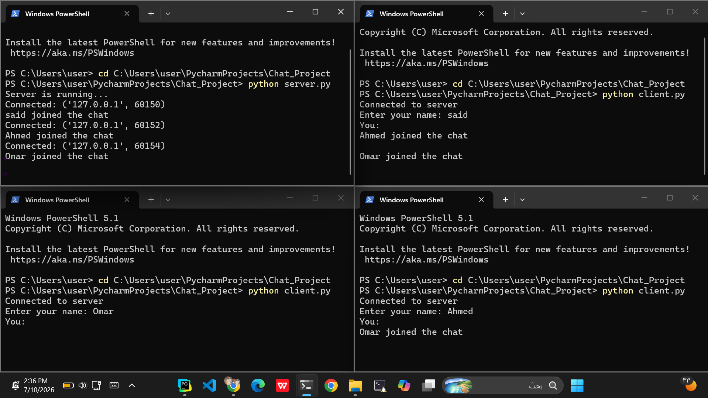
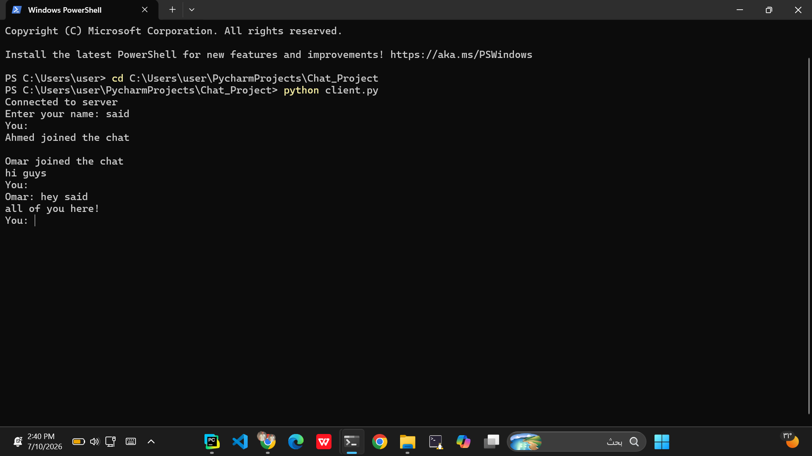
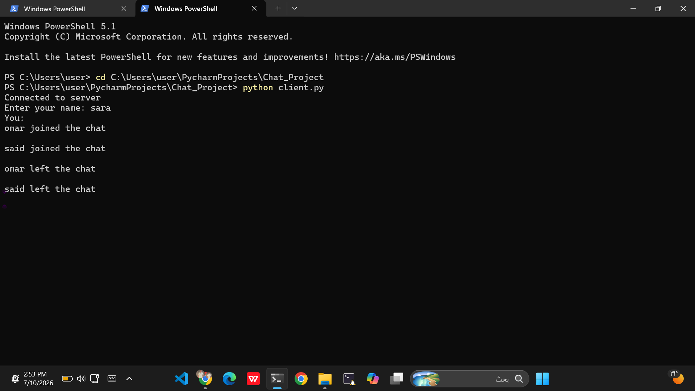

# Multi-User Chat Application

## Project Overview

This project is a TCP-based multi-user chat application developed using Python 3
The application follows a client-server architecture where multiple clients can
connect to a centralized server and exchange messages in real time.

The project uses Python built-in networking libraries:
- socket
- threading

No third-party networking frameworks were used.

---

## Project Structure
```text
Chat_Project/
│── server.py
│── client.py
│── README.md
│
└── images/
    │── server_running.png
    │── multiple_clients.png
    │── chat.png
    │── disconnect.png
```

### server.py

Responsible for:
- Creating and managing the TCP server socket.
- Accepting multiple client connections.
- Managing connected users.
- Broadcasting messages between clients.
- Handling client disconnections.

### client.py

Responsible for:
- Connecting to the server.
- Sending user messages.
- Receiving messages from other clients.
- Providing a command-line interface for interaction.

---

## Requirements

- Python 3.x installed.
- No external libraries are required.

Required built-in libraries:
- socket
- threading

---

## How to Run the Project

## 1. Start the Server

Open a terminal inside the project folder and run:

```bash
python server.py
```

The server will start listening for client connections.

Example output:

```text
Server is running...
```

## 2. Start the Clients

Open another terminal and run:

```bash
python client.py
```

Enter a unique nickname.

Multiple clients can connect by running `client.py` several times.

## Features

The application provides:

TCP socket communication.

Multiple simultaneous clients.

Thread-based client handling.

Unique nickname verification.

Real-time message broadcasting.

Join and leave notifications.

Exception handling for network errors.

Command Line Interface (CLI).

## TCP Protocol Justification

TCP was selected as the transport layer protocol for this chat application because
the system requires reliable and ordered communication.

TCP provides:

Reliable message delivery.

Correct message ordering.

Connection-oriented communication.

Error detection and recovery.

UDP was not selected because it does not guarantee message delivery or message order.
In a chat application, losing messages or receiving them in the wrong order would
negatively affect communication quality.

## Screenshots

The following screenshots demonstrate the application functionality:

Server running and accepting client connections.




Multiple clients connected to the server.




Real-time message exchange between users.




Handling client disconnection.



## Error Handling

The application handles different network problems, including:

Unexpected client disconnections.

Sending and receiving errors.

Server setup errors.

Port binding conflicts.

The server continues operating even if one client disconnects unexpectedly.

## Conclusion

This project demonstrates the implementation of a TCP-based multi-user chat application using Python.

The application successfully applies client-server architecture, TCP communication, socket programming, and multithreading to support real-time communication between multiple users.